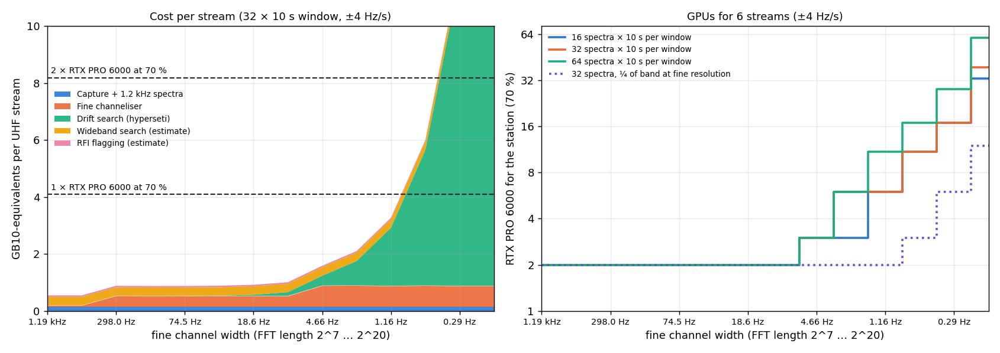

# LFT3-Earth backend sizing (first pass, 2026-11-14)

What compute does the full instrument need, if the DGX Sparks are only for development? This scales the
single-board measurements on the Spark (`docs/runtime.md` §6, `pipeline/bench/`) to the full station and maps them
onto PCIe GPU servers. GPUs considered: NVIDIA RTX PRO Blackwell cards, with L40S and L4 for comparison. Not
considered: H100/H200/B200 or NVIDIA's own servers.

**Status:** an estimate built from measurements. Each number is tagged **measured** (on the GB10 with this
code), **derived** (measured, then scaled), or **estimate** (not yet measured). The estimates that matter most
are the wideband search and the fused Hz-resolution channeliser. §8 lists the checks to run before buying.

## 1. What has to be processed

| | Value | Source |
|---|---|---|
| Boards | 6 RFSoC 4x2: 5 UHF + 1 VHF, fid 0–5 | xlsx *Final Specs* |
| Links | **1 × 100 GbE per board → 6 streams** | xlsx *Final Specs*; confirmed by the user 2026-11-14 |
| Per stream | 4 inputs = 2 dual-pol beams, 6144 × 152.6 kHz channels (937.5 MHz), 8+8-bit | packet_format.md |
| Per stream rate | 3.75 G complex samples/s, 7.5 GB/s, 60.95 Gb/s on the wire (+10 Gb/s during a DDR dump) | packet_format.md, live |
| Station | 6 streams, 12 dual-pol beams, **366 Gb/s** continuous, 426 Gb/s if all boards dump at once | |
| VHF board | Same packet format, but 2 of its 4 inputs are zero padding, so only half of its processing is real | xlsx *Data Rates* |

Earlier docs sized for "5 boards × 2 links". That was wrong, and those docs are now corrected.

## 2. Unit of cost: the GB10-equivalent

Every stage measured so far is **memory-bandwidth bound**, not FLOP bound: scatter at ~200 GB/s, the warp FFT at
~167 GB/s, cuFFT 2^17, and the hyperseti dedoppler. A 2^17 FFT of a full stream is ~320 GFLOP/s, about 0.3 % of a
modern GPU. So costs are expressed in **GE = fraction of one GB10 GPU (273 GB/s LPDDR5x)** and moved to other
GPUs by memory-bandwidth ratio:

| GPU | Memory | Bandwidth | GE | Power | Price (ballpark, get quotes) | GPUDirect RDMA |
|---|---|---|---|---|---|---|
| GB10 (Spark) | 128 GB shared | 273 GB/s | 1.0 | | | no |
| L4 | 24 GB | 300 GB/s | 1.1 | 72 W | ~$2.5k | yes |
| L40S | 48 GB | 864 GB/s | 3.2 | 350 W | ~$7–9k (poor value now) | yes |
| RTX PRO 4500 Blackwell | 32 GB | 896 GB/s | 3.3 | 200 W | ~$3k | yes (pro card) |
| RTX PRO 5000 Blackwell | 48 / 72 GB | 1344 GB/s | 4.9 | 300 W | ~$5–7k | yes (pro card) |
| **RTX PRO 6000 Blackwell Server** | **96 GB** | **~1600 GB/s** | **5.9** | 600 W, passive | **~$8–14k** | yes (pro card) |

The bandwidth ratio is a slightly conservative scale factor. The GB10 shares its bus with the CPU and the NIC's
DMA, and that contention is already in the measurements. A discrete card's GDDR serves only the GPU.
**GeForce cards (RTX 5090 etc.) are excluded:** NVIDIA's GeForce driver licence restricts datacenter use, there
are no passive server versions, and GPUDirect RDMA from the NIC is not supported on GeForce. DAQIRI's GPU path
needs that RDMA. Confirm GPUDirect on the chosen RTX PRO card with DAQIRI before ordering (§8).

## 3. Cost per stream

| Stage | GE per stream | Basis |
|---|---|---|
| Capture + scatter into the ring + 1.2 kHz fine spectra + coarse quick-look | 0.12–0.19 → **0.15** | **measured** (0.8 ms per 6.71 ms block; 0.19 per stream with 5 streams contending) |
| Hz channeliser, Nf = 2^17 (1.16 Hz), fused (int8 load + detect/accumulate in cuFFT callbacks) | **0.75** | **derived**: plain cuFFT 2^17 measured at 3.1× real time per dual-pol beam = 0.65 GE per stream; fusing adds little traffic |
| ↳ same, unfused (separate convert, FFT, \|X\|², accumulate) | 2.5 | **measured** (0.8× real time per beam) |
| Narrowband search, hyperseti, Stokes I, full band, 32 × 10 s window, ±4 Hz/s | **2.1** | **derived** from the hyperseti benchmark below |
| Wideband path: detect + integrate coarse data, heimdall-type dedispersion, both beams | **0.3** (0.1–1) | **estimate**, the least known number |
| GPU RFI flagging (spectral kurtosis) on fine data | 0.05 | estimate |
| **Interim system** (1.2 kHz spectra + light search + wideband) | **~0.5** | |
| **Hz system** (full band at 1.16 Hz + hyperseti + wideband) | **~3.35** | |
| Hz system on ¼ of the band (the rest at 1.2 kHz) | ~1.2 | cost scales linearly with the Hz bandwidth |

### Narrowband search (measured 2026-11-14, `pipeline/bench/search/bench_hyperseti.py`)

hyperseti brute-force dedoppler on the GB10, synthetic data, 2^20 channels of 1.164 Hz, 10 s spectra. It finds the
injected 0.05 Hz/s tone in every run.

| Spectra per window | Window | max drift | Drift trials | Speed | GE per stream (1.61 G channels) |
|---|---|---|---|---|---|
| 16 | 160 s | ±4 Hz/s | 191 | 6.2 Mchan/s | 1.6 |
| **32** | **320 s** | **±4 Hz/s** | 383 | **2.5 Mchan/s** | **2.1** |
| 64 | 640 s | ±4 Hz/s | 767 | 0.7 Mchan/s | 3.6 |
| 32 | 320 s | ±1 / ±10 Hz/s | 255 / 447 | 3.5 / 2.1 Mchan/s | 1.5 / 2.4 |

* hyperseti's "stepped" plan makes the cost depend only weakly on the drift range. It grows roughly in
  proportion to the **number of spectra per window**, so window length and integration time drive the cost.
* The kernel reaches ~3×10¹⁰ cell sums/s, well below what the GPU can do. A tiled kernel (or seticore's Taylor
  tree) may be several times faster, but that is not measured. Until it is, **the search is the largest compute
  item**: about 3× the Hz channeliser.
* At the interim 1.2 kHz resolution the search is negligible: about 1000× fewer channels.

### Live search cost against resolution (measured 2026-11-20, `pipeline/bench/resolution/resolution.py`)

The live search (`lft3.search.core`, hyperseti with the `optimal` plan) on one 2^17-channel gulp of 64 spectra,
idle GB10, scaled to a full-band stream: per gulp ~21 ms floor + ~0.15 ms per drift trial. Real-time factors with
1 s spectra: 1192 Hz 106×, 149 Hz 7.3×, 18.6 Hz 1.7×, 2.33 Hz 0.11×, 1.16 Hz 0.03× (the last three at ±4 Hz/s).
At 1.16 Hz and 1 s spectra that is ~30 GB10 per stream, so the figures above (10 s spectra, 32-spectrum windows,
`stepped` plan) remain the planning basis; the `optimal` plan the 1.2 kHz configuration uses would cost ~6× more
trials there. Details and the whole-chain matrix: docs/runtime.md §6.

Raw buffer for search triggers: a live-search trigger can only dump what is still in the raw buffer. To record the
window a hit came from, the buffer must cover window + search latency: ~70 s at 1.2 kHz with 64 s windows,
i.e. ~500 GB per stream of host RAM (7.5 GB/s); with the 2 s ring a trigger records the signal as it is when found.

Recording: the FBH5 writer compresses ~160 MB/s per stream with 4 threads on the GB10 (50 MB/s single-threaded),
enough for the fine product up to ~4000 fine channels per board channel per second of integration. Production
servers with more cores per stream scale this linearly; it is CPU, not GPU, load (§5).

## 4. Station totals and GPU count

Totals: 5 UHF streams plus the VHF stream at half processing (its padded inputs are skipped). Plan for **≤ 70 %**
GPU use, because the wideband and search numbers are uncertain.

| Scenario | Station total | RTX PRO 6000 | RTX PRO 5000 | RTX PRO 4500 |
|---|---|---|---|---|
| Interim (1.2 kHz) | ~2.8 GE | 1 GPU would do; **use 1 per server** (8 % per stream) | 10 % per stream | 14 % per stream |
| Hz on ¼ of the band | ~6.5 GE | 20 % per stream | 24 % per stream | 36 % per stream |
| **Hz, full band** | **~18.5 GE** | **57 % per stream → 1 GPU per stream, 6 GPUs** | 68 % per stream: fits, no margin | 102 %: does not fit |

**GPU memory per stream** (Hz, full band): about 30 GB if the corner-turn ring sits on the GPU. That is ring
2 × 6.4 GB per 2^17 FFT, Stokes-I accumulator 6.4 GB, output buffer 6.4 GB, and FFT and search workspace ~3 GB.
It drops to ~16 GB if the ring moves to host RAM (7.5 GB/s over PCIe). An RTX PRO 6000 (96 GB) holds one stream
with ample room, and could hold three. A 48 GB RTX PRO 5000 holds one.

**Conclusion:** one RTX PRO 6000 per board covers the full-band Hz system, with about 40 % headroom for a slower
wideband search or a longer search window. The same hardware runs the interim system at under 10 % load. A
cheaper RTX PRO 5000 per board also fits, but only with no headroom.

## 5. Host side: network, CPU, RAM, PCIe

* **Network:** 6 direct 100 GbE links, no switch, the same as on the Spark. A dual-port ConnectX-6 Dx / ConnectX-7
  serves 2 boards. With GPUDirect RDMA, packets go from the NIC into GPU memory, and the host memory bus is not
  in the data path. That also removes the NIC-drop failure seen on the Spark under memory-bus contention
  (runtime.md decision 13). Put each NIC and its GPUs under the same PCIe root or switch.
* **PCIe:** per stream, 7.6 GB/s NIC → GPU. Gen5 x16 GPU slots and a Gen5 NIC have room to spare.
* **CPU:** per stream, 1 DAQIRI busy-poll core, the master and processing threads, and ~1 core for readers and
  writers, so ~4 cores. Add the search host process, compression and monitoring. A **single-socket EPYC (Zen 5),
  24–32 cores**, avoids NUMA placement problems and has 128 PCIe Gen5 lanes.
* **RAM** (host), per stream:
  * search window: 32 × 6.4 GB = 206 GB in fp32 or 103 GB in fp16, plus the window being filled (~1.5×);
  * **raw-beam transient buffer** (architecture notes: as long as the widest dispersion or drift plus pipeline
    latency): **7.5 GB per second of buffer** (3.75 if requantised to 4-bit). The dispersion sweep at DM 1000 is
    1.2 s at 1.5–2.5 GHz, but 43 s at 0.3–1.24 GHz and ~1100 s on the VHF band. **The buffer length is a science
    decision, and it is the largest RAM item:**

  | Raw buffer | per stream | 2-board server, incl. fp16 search buffers |
  |---|---|---|
  | 2 s (today's ring) | 15 GB | ~384 GB |
  | 10 s | 75 GB | ~512 GB |
  | 30 s | 225 GB | ~768 GB–1 TB |

  Don't put this buffer on NVMe. Writing 7.5 GB/s continuously is ~650 TB/day per stream, which wears out drives
  in weeks. DDR5 prices have risen sharply in 2025–26, so RAM may cost as much as a GPU.

## 6. Storage

| Product | Volume | Note |
|---|---|---|
| Fine spectra, 1.2 kHz, 1 s, Stokes I | ~0.38 TB/day per stream, **2.3 TB/day** for the station | with the current 1.43× compression |
| Coarse quick-look | negligible | |
| Hz spectra, 2^17, 10 s, Stokes I | 0.64 GB/s = **56 TB/day per stream** | cannot be kept. Keep hits plus snippets, or chosen subbands |
| Triggered dump, all 6 boards (1 s raw + 4 GiB DDR each) | ~71 GB per trigger | 1.7 TB/day at 1/hour, 10 TB/day at 1 per 10 min. The 1-per-10-s maximum (610 TB/day) is not sustainable |

So **trigger policy, not the spectra, decides the storage size.** As a starting point: per server, ~30 TB of local
NVMe for staging; plus a central storage server, ~0.5 PB usable (ZFS/RAID-Z2), on a 25/100 GbE network separate
from the data links. That holds weeks to months, depending on the trigger rate.

## 7. Recommended configurations

**A. Recommended: 3 capture/processing servers, 2 boards each, plus a head node and storage.**

| Per server | |
|---|---|
| Chassis | 2U, single-socket EPYC 9005, 24–32 cores |
| GPU | **2 × RTX PRO 6000 Blackwell Server** (one per board) |
| NIC | 1 × ConnectX-7 (or -6 Dx) **2 × 100 GbE**, direct to 2 boards |
| RAM | 512 GB (10 s raw buffer), 768 GB–1 TB for 30 s |
| Disk | OS mirror + 4 × 7.68 TB NVMe (U.2/E3.S) |
| Uplink | 25 GbE to storage / head node; 1 GbE to the board M&C network |

* Ballpark: ~$40–60k per server, mostly GPUs and RAM; **~$150–200k for 3**. Add a head node (~$5–8k: M&C,
  Prometheus/Grafana, orchestration) and 0.5 PB of storage (~$50–80k). Prices are early-2026 street prices and
  move fast. Get quotes.
* Failure domain: one server = 2 boards. A **4th identical server** is worth considering. It is a hot spare for
  any 2 boards (re-cable or switch), a development box, and capacity for offline reprocessing or heavier
  searches.

**B. One server per board (6 × 1U, 1 GPU + 1 port each).** The smallest failure domain, and the same GPU count,
but 6 chassis, 6 CPUs and 6 sets of RAM. More expensive for the same capacity. Only worth it if losing 2 boards at
once is unacceptable.

**C. Interim system only (1.2 kHz), cheapest.** Configuration A with 1 × RTX PRO 4500 per server, or Sparks.
Upgrade the GPUs later. Choose the chassis (PSU, airflow, slots) for the RTX PRO 6000 from the start.

**D. One 8-GPU server behind a switch (feasible; not the first choice).**

| Item | Need | Fits? |
|---|---|---|
| Network | 366 Gb/s continuous, 426 Gb/s if all boards dump: **3 × 200G** (2 boards per link, 122 / 142 Gb/s = 71 %) or 2 × 400G. Not 3 boards per 200G: 183 Gb/s continuous, over 200 during a dump | yes |
| PCIe, NIC → GPU | 7.6 GB/s per stream (8.9 during a dump), 46–53 GB/s total; ~15 % of a Gen5 x16 GPU link | yes |
| PCIe, NIC | 2 streams per 200G NIC = 15–18 GB/s on a Gen5 x16 | yes |
| PCIe, GPU → host | +7.5 GB/s per GPU if the raw buffer is in host RAM (the opposite direction; DDR5 has hundreds of GB/s) | yes |
| PCIe lanes | 6 GPUs × 16 + 3 NICs × 16 + NVMe ≈ 160 lanes, over a single EPYC's 128 | **needs a dual-socket board or PCIe switches** |
| RAM | ~1.4 TB (10 s raw buffer), 2.2 TB+ (30 s) | dual socket, all channels populated |
| Power | 6–8 × 600 W GPUs + 2 CPUs ≈ 5–6 kW in one 4U box | check rack power and cooling |

* **PCIe layout matters more than bandwidth.** GPUDirect wants each NIC under the same PCIe switch as the GPUs it
  feeds (the usual 8-GPU design: 1 NIC per 2 GPUs). Never route NIC → GPU across the socket link (xGMI): it is
  slow or unsupported for GPUDirect. NVIDIA's RTX PRO Server reference design (8 × RTX PRO 6000, ConnectX-8 with
  a built-in PCIe switch) has this layout. Vendor configurations and prices not yet checked.
* 6 GPUs carry the streams, which leaves 2 slots for searches and the wideband path.
* **One point of failure:** a server or switch fault stops all 6 boards. Cost is about the same as A: the GPUs
  are identical, D saves chassis and CPUs, and adds a switch (~$10–25k) and expensive RAM.
* **Preferred variant: the switch with 2–3 servers**, which can move boards between servers in software.

**Requirements for any switched setup** (from the current firmware):

1. **Broadcast floods.** Each board sends to the broadcast MAC until `lft3-board set-dest-mac`, and again after
   every reprogram (the ARP table is lost). One board then floods 61 Gb/s to every port. Put each board port in a
   VLAN, or isolate it, so it can reach only its own server port.
2. **MAC aging.** The servers send almost nothing, so the switch can forget their MACs and flood unknown unicast.
   Fix: static MAC entries, or a periodic keepalive from each NIC.
3. **Fixed destination IP** (10.17.16.10, in the firmware). Harmless on a layer-2 switch; DAQIRI steers on source
   IP and port. Each board needs its own source IP (check that the firmware allows this).
4. **No flow control.** The boards appear to ignore 802.3x pause (runtime.md decision 13), so a full switch port
   drops packets. Keep every server link at 70 % load or less.

## 8. Before buying

1. **Port the runtime to x86_64 + a discrete GPU** (today: arm64, sm_121, unified memory):
   * build the container for amd64 and sm_120;
   * use DAQIRI `gpudirect` memory regions instead of `host_pinned`;
   * check every place that reads GPU-ring data from the CPU. On the Spark that is free (unified memory); on a
     discrete card it needs an explicit copy (coarse quick-look derivation, dump writer).
2. **Rent or borrow one RTX PRO 6000 server** for a week:
   * run `pipeline/bench/capacity` (now ×N streams per GPU) and `pipeline/bench/search/bench_hyperseti.py`;
   * check the bandwidth scaling assumption in §2;
   * check that GPUDirect RDMA works with a ConnectX NIC.
3. **Benchmark the wideband search** (heimdall on detected coarse data, chosen DM range and pulse widths). It is
   the least known cost here (0.1–1 GE per stream).
4. **Write the fused Hz channeliser** (cuFFT callbacks or a custom kernel) and measure it; 0.75 GE is derived,
   not measured.
5. **Science decisions that move the numbers:**
   * Hz-resolution bandwidth (full or a subband: linear cost);
   * search window length (cost ∝ spectra per window);
   * raw transient buffer length (RAM);
   * trigger rate (storage).

## 9. Sizing vs fine resolution and drift search

* **Interactive version:** [`sizing_figures/sizing_calculator.html`](sizing_figures/sizing_calculator.html). Open
  it in a browser. Sliders: FFT length, band fraction, integration, spectra per window, drift range, GPU type,
  planned load, boards per server, raw buffer length, and the two unmeasured inputs (wideband cost, search-kernel
  speed-up).
* **Script:** [`sizing_figures/sizing_model.py`](sizing_figures/sizing_model.py) uses the same model, writes the
  figure and prints the table below.
* **Measured inputs:**
  * the cuFFT FFT-length sweep on the GB10, as GE per stream:

    | | FFT only | with separate convert / detect / accumulate passes |
    |---|---|---|
    | single pass, 2^7–2^14 | 0.27 | 2.0–2.7 |
    | two passes, 2^15–2^20 | 0.63–0.65 | 2.3 |

  * the warp kernel at ≤ 256 points: 0.045;
  * the hyperseti cost per cell (§3).
* **Drift trials:** hyperseti's stepped plan, ≈ nt × (1 + log2(drift span in channels / nt)) per sign. This fits
  the measured trial counts to within ~5 %.

Station GPU count at 70 % planned load, 10 s spectra, ±4 Hz/s, full band at fine resolution:

| Fine channel | GE per UHF stream (16 / 32 / 64 spectra) | RTX PRO 6000 | RTX PRO 5000 48 GB | GPU memory per stream |
|---|---|---|---|---|
| 1.19 kHz (2^7) | 0.55 / 0.55 / 0.55 | 2 / 2 / 2 | 3 / 3 / 3 | 18 GB |
| 149.0 Hz (2^10) | 0.87 / 0.87 / 0.88 | 2 / 2 / 2 | 3 / 3 / 3 | 18 GB |
| 18.6 Hz (2^13) | 0.91 / 0.92 / 0.95 | 2 / 2 / 2 | 3 / 3 / 3 | 19 GB |
| 4.66 Hz (2^15) | 1.52 / 1.59 / 1.83 | 3 / 3 / 3 | 3 / 3 / 6 | 21 GB |
| 2.33 Hz (2^16) | 1.95 / 2.10 / 2.71 | 3 / 6 / 6 | 6 / 6 / 6 | 24 GB |
| **1.16 Hz (2^17)** | 2.90 / **3.27** / 4.73 | 6 / **6** / 11 | 6 / 6 / 11 | 31 GB |
| 0.58 Hz (2^18) | 5.14 / 6.01 / 9.40 | 11 / 11 / 17 | 12 / 12 / 17 | 55 GB |
| 0.29 Hz (2^19) | 10.11 / 12.10 / 19.84 | 17 / 17 / 28 | 18 / 23 / 33 | 106 GB |

How to read it:
* **Down to ~20 Hz, the channeliser and the search are cheap.** Capture, the FFT and the wideband estimate
  dominate, and 2 GPUs carry the station. At this end GPU memory sets the count: the default 2 s ring is 15 GB per
  stream. With 1 s rings, one GPU would carry the station.
* **Below ~5 Hz the drift search takes over**, and it grows faster than linearly:
  * halving the channel width doubles the channels;
  * it also roughly doubles the drift span in channels, so the trial count grows too.
  At 1.16 Hz the search is ~60 % of the cost.
* **Window length matters more than drift range:**
  * at 1.16 Hz, 64 spectra per window instead of 32 nearly doubles the GPUs (6 → 11);
  * ±1 instead of ±10 Hz/s changes the cost by under 2×.
* **0.58 Hz and below** needs 11–17+ GPUs. GPU memory per stream also passes 50 GB: the ring has to cover 2 FFT
  lengths, 3.4 s at 2^18.
* **The cheapest lever is the band fraction:** Hz resolution on ¼ of the band costs 1.2 GE per stream, less than
  the full band at 4.66 Hz (1.6), and the station needs 2 GPUs (the dotted line in the figure).
* **A faster search kernel** (the "search kernel speed-up" slider) at 1.16 Hz:

  | Speed-up | GE per stream | GPUs |
  |---|---|---|
  | 1× (as measured) | 3.27 | 6 |
  | 2× | 2.25 | still 6 (one stream per GPU) |
  | 4× | 1.74 | 3 (two streams per GPU, then memory-limited) |

  That makes optimising the search kernel worth more than any other software work.
